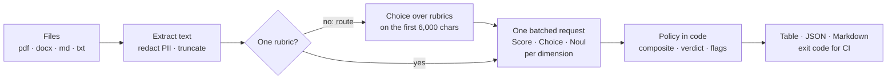

# typesafe-doc-eval

Score documents on quality, completeness, audience fit, tone, and readiness with
[TypeSafe](https://typesafe.ai)'s System One API. The `doc-eval` CLI evaluates a set of files
(PDF, DOCX, Markdown, or text) against rubrics of typed judgments and reports a composite score,
a verdict, and a status for each one. The plugin's `doc-eval` skill lets Claude Code run the CLI
and explain the results.

## Quick start

```sh
export TYPESAFE_API_KEY=...   # from https://typesafe.ai
uv tool install "git+https://github.com/victorkjung/claude-plugins-official#subdirectory=plugins/typesafe-doc-eval"

doc-eval path/to/docs/                    # route each file to the best-fitting preset
doc-eval lease.pdf -p property --details  # one preset, with a per-dimension breakdown
doc-eval memos/ -p deal-memo --audience "LPs in a real estate fund" -f markdown -o report.md
```

`pipx install` works with the same URL. To see the output format without an API key, run
`doc-eval examples/docs --mock` (synthetic answers, not evaluations) or `--dry-run` (shows the
exact requests and sends nothing).

In Claude Code, load the plugin and ask in plain language, for example "evaluate the leases in
./leases":

```sh
claude --plugin-dir plugins/typesafe-doc-eval   # from a checkout of this repo
```

To install it permanently from a marketplace instead, note that Claude Code reserves the name this
fork inherited, `claude-plugins-official`, for Anthropic's own GitHub repositories, so
`claude plugin marketplace add victorkjung/claude-plugins-official` is refused. Rename `name` in
`.claude-plugin/marketplace.json` (for example to `victorkjung-plugins`), then run
`claude plugin install typesafe-doc-eval@victorkjung-plugins`.

## Presets

| Preset | Documents | Dimensions |
|---|---|---|
| `property` | Leases and amendments, rental applications, inspection and maintenance reports, tenant notices, vendor contracts | Clarity, Completeness, Specificity, Audience fit, Readability, Tone, Next steps, Verdict |
| `deal-memo` | Investment memos, underwriting, pitch-deck text, market analyses | Thesis, Completeness, Evidence, Risk analysis, Audience fit, Readability, Tone, Decision readiness, Verdict |
| `product-spec` | PRDs, specs, RFCs and design docs, runbooks, postmortems | Problem clarity, Completeness, Specificity, Trade-offs & risks, Audience fit, Readability, Tone, Actionability, Verdict |
| `outbound` | Marketing copy, property listing descriptions, emails and newsletters, blog posts | Message clarity, Key details, Value & proof, Audience fit, Readability, Tone, Call to action, Verdict |

Each covers three families: **quality and completeness** (0-4 scores), **audience and tone**
(scores plus a tone label), and **verdict and readiness** (a readiness score plus an
approve / revise / reject verdict). Without `--preset`, each document is routed to the preset whose
description fits it best. `doc-eval --list-presets` shows them, and `doc-eval --show-rubric NAME`
prints one.

## How scoring works



- **Each dimension is one TypeSafe question.** Scores return a probability-weighted level (for
  example 2.6 of 4) with a confidence; choices return a label with probabilities; nouls return
  P(yes). A document's questions all go out in one request, so they run in parallel and cannot
  influence each other.
- **Code decides, not the model.** The composite is the weighted mean of the score dimensions
  (and of any weighted yes/no dimensions in custom rubrics), scaled to 0-100. The status comes
  from explicit rules:

  | Status | Rule |
  |---|---|
  | pass | Verdict approve and composite ≥ pass bar (75) |
  | revise | Verdict revise, or composite between the fail bar (50) and the pass bar |
  | review | Verdict and composite disagree, verdict confidence < 0.5 (unless the composite fails on its own), a flagged answer (such as a hostile tone), a truncated document, or a document that may not fit its rubric |
  | fail | Verdict reject, or composite < fail bar |

- **Thresholds are policy.** Change them per run (`--pass-at`, `--fail-below`) or per rubric
  (`policy:`). The JSON output keeps every raw answer (levels, probabilities, confidence), so
  downstream code can re-weight or re-threshold without running inference again.

## Output and exit codes

- `table` (default): a documents × dimensions matrix per rubric, a transposed view on narrow
  terminals, and the reasons behind every non-pass status. `--details` adds a card per document
  with score bars, confidence, and the rubric description of the most likely level.
- `json`: everything, including raw probabilities, routing, redaction counts, and token usage.
- `markdown`: a shareable report for docs, PRs, or email.

Exit codes are 0 for ok, 1 when a document's status is at least `--fail-on` (default `fail`;
`revise` means "everything must pass"), 2 for a usage or rubric error, 3 when a document could
not be evaluated, and 4 for an internal error. For a CI gate, `--fail-on review` is the
conservative choice: it also stops documents that need a person's judgment.

## Custom rubrics

Copy a preset (`doc-eval --show-rubric outbound > mine.yaml`) or start from
[`examples/rubrics/owner-report.yaml`](examples/rubrics/owner-report.yaml), which uses all three
question types, then run it with `--rubric mine.yaml`. Several `--rubric` and `--preset` values
can be combined; documents are then routed among them. The skill's
[rubric guide](skills/doc-eval/SKILL.md#custom-rubrics) covers the schema and TypeSafe's
question-design rules. Check a rubric with `--dry-run -f json` before spending tokens.

## Data handling, cost, and limits

- Document text is sent to `api.typesafe.ai`. Before sending, doc-eval replaces emails, phone
  numbers, SSNs, Luhn-valid card numbers, and credentials (API tokens, password and key fields,
  private keys) with placeholders such as `[EMAIL]`. It is pattern-based: unlabeled 9- or 10-digit
  numbers, names, and addresses are not masked, so treat it as a safety net and not a guarantee.
  `--no-redact` turns it off.
- Documents longer than `--max-chars` (default 120,000 characters) keep their head and tail and go
  to review. Scanned PDFs without a text layer need OCR first.
- TypeSafe bills input tokens. Expect the document's length plus roughly 1,300-1,700 tokens of
  rubric questions per document, and a small routing request when routing. `--dry-run` estimates
  per file.
- The model defaults to `jev-latest`; set `--model` or `TYPESAFE_DEFAULT_MODEL` to pin a version.
- Scores are calibrated judgments, not ground truth. Before relying on the default thresholds for
  gating, check them against documents whose quality you already know.

## Development

```sh
cd plugins/typesafe-doc-eval
uv run --group dev pytest
uv run --group dev ruff check && uv run --group dev pyright
```

Tests run the real TypeSafe SDK against a scripted HTTP transport, so they need no network or key.
